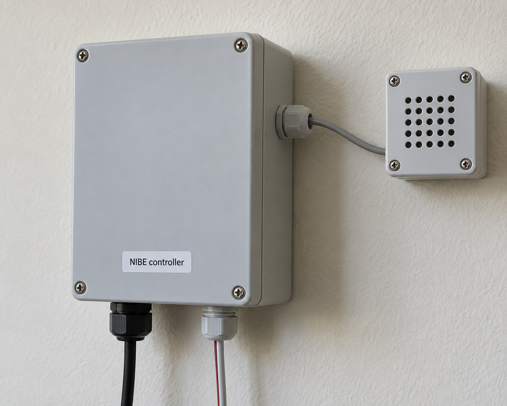
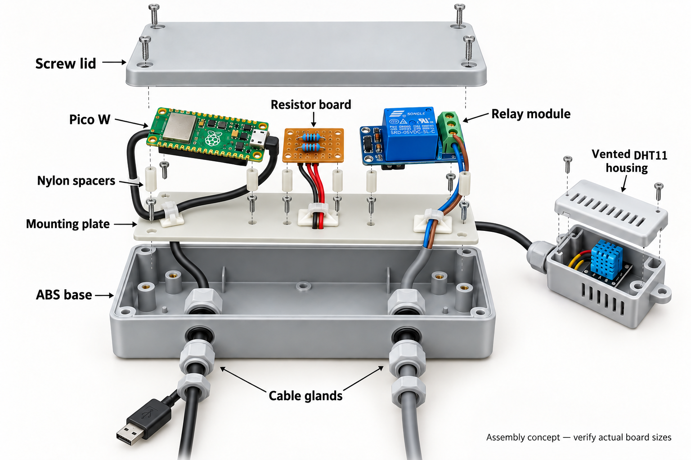

# Mounting the controller and wireless sensor

The current design uses **two separate enclosures**: a USB-powered controller with the relay, and a wireless room sensor with its own Pico, Waveshare Pico-UPS-B, DHT11, and battery. There is no sensor cable between the boxes. Both devices require local Wi-Fi communication.

Use off-the-shelf screw-lid plastic boxes and basic hand tools. The sizes below are starting recommendations, not verified minimum dimensions. Measure the actual boards, battery, connectors, and cable bends before buying or drilling.

## Controller enclosure

Start with approximately **160 × 100 × 60 mm external dimensions**, with internal mounting bosses and preferably external wall-mounting tabs. A larger box makes wiring and servicing easier. [Hammond's 1591XX range](https://www.hammfg.com/electronics/small-case/plastic/1591xx) is one example; select using the manufacturer's usable internal dimensions and drawing.

Fit a **2–3 mm insulating plastic mounting plate**, a small soldered prototyping board for the resistors and wire distribution, and the relay. Keep its COM/NO terminals facing the heater cable entry. Position the Pico antenna end clear of boards, wires, and metal hardware; follow the [Pico datasheet](https://datasheets.raspberrypi.com/picow/pico-2-w-datasheet.pdf) keep-out guidance.

| Attachment | Recommended starting hardware |
| --- | --- |
| Pico | Four M2 nylon spacers, about 6 mm high, with matching screws and nuts. Pico mounting holes are 2.1 mm. |
| Relay | Nylon spacers about 6–10 mm high; use M3 only if its existing holes accept M3. Otherwise match the holes or use an insulating board holder. |
| Prototyping board | Nylon spacers and screws matched to its actual mounting holes. |
| Plate to enclosure | The screws specified for the chosen enclosure's bosses. Do not assume these take M3. |
| Lid | The supplied enclosure screws. |

Check screw engagement, screw-head clearance, and space beneath solder joints. Do not drill through a module's circuit board. Cable-tie mounts can tidy wires but should not carry the boards.

Allow approximately **20–30 mm for the USB plug and cable bend**, adjusted to your actual lead. Keep the mains USB adapter outside the enclosure.

## Sensor enclosure

Select a ventilated plastic box that fits the **complete Pico/UPS stack and battery**, with clearance for the battery connector, charging connection, and DHT11. A **100 × 70 × 40 mm external box** is a starting candidate, not a fit guarantee. The old tiny DHT-only housing is too small for this assembly.

Use the UPS manufacturer's mounting arrangement and battery requirements. Verify battery connector polarity. Secure the battery without crushing, piercing, or bending it; keep screws and solder joints away from the pouch. Disconnect USB and the battery before wiring.

Put the DHT11 near ventilation openings and away from the Pico, UPS, and battery charging heat. A short internal three-wire harness connects it to the **sensor Pico**. Position the enclosure in representative room air, away from the heater, direct sunlight, and drafts. Recheck the temperature correction after installation. No waterproof rating is implied after drilling ventilation holes.

## Secure electrical connections

Use a soldered prototyping board, approximately **50 × 70 mm** as a starting size, for the controller's 1 kΩ series resistor, 10 kΩ pull-down, and wire distribution. Two 20-way, 2.54 mm female sockets can make a header-equipped Pico removable; leave its antenna end beyond the carrier board's edge.

For detachable module harnesses, use pluggable screw-terminal blocks compatible with the prototyping board's hole pattern, or locking crimp connectors. A 3.5 mm pitch terminal block will not necessarily fit a 2.54 mm grid. Label both halves and follow module labels rather than assuming header order. Avoid loose breadboard jumper leads in the installed system.

| Device | Connection | Pico physical pin |
| --- | --- | ---: |
| Controller | Relay `+` → VBUS, USB 5 V | 40 |
| Controller | Relay `−` → GND | 38 |
| Controller | Relay `S` → GP14 through 1 kΩ | 19 |
| Controller | 10 kΩ pull-down between GP14 and GND, before the 1 kΩ resistor | 19 → 38 |
| Sensor | DHT11 `+` → 3V3 OUT | 36 |
| Sensor | DHT11 `out` / `S` → GP15 | 20 |
| Sensor | DHT11 `−` → sensor GND | 38 |

Each module connects to its own Pico's ground. The boxes do not need a common ground. The project's relay module was tested for 3.3 V signal compatibility; check any replacement module before use.

For internal low-voltage wiring, **0.14–0.25 mm² stranded wire** is a practical starting choice, subject to connector specifications. Use ferrules where appropriate for the terminal type, heat-shrink on exposed solder joints, and strain relief.

The heater cable connects directly to the relay's existing terminals: **COM → NIBE X1:3, NO → X1:4; NC unused**. This is an isolated potential-free contact. Do not connect Pico power or ground to that pair. Route the heater cable separately from the controller power and signal harness. See the [heater installation instructions](../README.md#connect-to-the-nibe-fighter-1230).

## Cable entries and assembly

1. Lay out the complete assemblies with connectors plugged in. Check lid clearance and service access before drilling.
2. Fit the insulating plate and board spacers. Ensure solder joints cannot touch hardware or other boards.
3. Provide two controller entries: USB power and the two-core heater contact cable. Match gland clamping ranges to actual cable diameters. Use a split gland for a preterminated USB lead or a panel-mounted USB extension; do not cut the lead to fit an ordinary gland.
4. Provide charging access for the sensor box and unobstructed ventilation near the DHT11. No third controller gland for a sensor cable is needed.
5. Drill and deburr the holes; remove all swarf before fitting electronics. Allow room for gland locknuts inside.
6. Solder and insulate connections. Secure cables with service slack so they do not pull on headers or terminals.
7. Run the [bench tests](../README.md#bench-tests-before-connecting-the-heater) with the heater disconnected, including sensor-power-loss and schedule-timeout tests.
8. Mount both boxes in dry indoor locations. Have someone qualified isolate the heater before accessing its terminals.

## Historical illustrations

**These images show the previous single-Pico design with a wired DHT11. They are retained for mechanical inspiration only and are not wiring instructions for the current two-device design.** The sensor cable, third gland, tiny sensor housing, and combined connection map do not apply to the current setup.

The previous [outside SVG](images/enclosure-outside.svg), [inside SVG](images/enclosure-inside.svg), and [interactive concept](enclosure-preview.html) also show the old layout. Use the connection tables above for the current build.

The realistic and exploded images were generated with the built-in image generation tool. Their [prompts](enclosure-image-prompts.txt) record the original design. All artwork is conceptual, not a photograph of a completed installation or a dimensioned manufacturing drawing.
